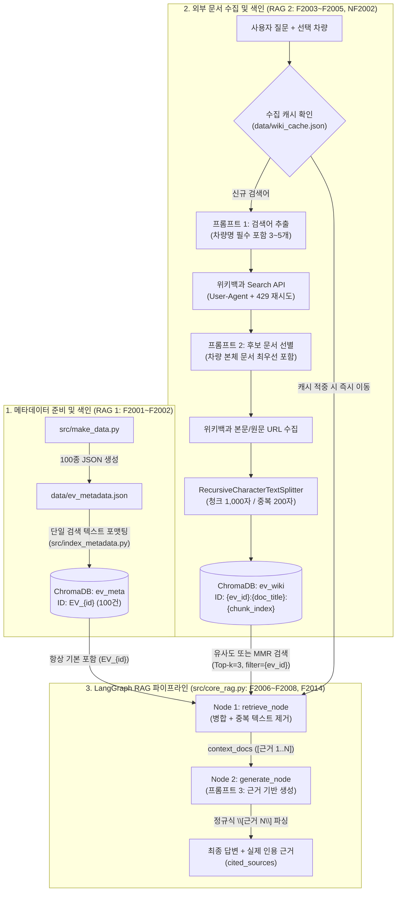

# 2. RAG 파이프라인 설계 문서 — Volt-Spec

> 본 문서는 명세서 2장(프로젝트 기획) 및 6장 2절(RAG 파이프라인 설계문서 제출 요건)의 모든 필수 항목을 포함하여 작성되었다.

---

## 2.1 전체 파이프라인 구조 및 데이터 흐름

`Volt-Spec`은 **정형 항목 메타데이터(`ev_meta`)**와 **외부 위키백과 기술 문서(`ev_wiki`)**를 분리 색인하고, **LangGraph**의 `retrieve` 노드와 `generate` 노드를 통해 병합 검색·인용 답변을 수행하는 구조로 설계하였다.



---

## 2.2 항목 텍스트 설계 (F2001)

- **설계 목적**: 사용자가 제조사, 차급(SUV/세단/픽업), 전용 플랫폼(E-GMP, MEB, PPE, J1, Ultium 등), 배터리 용량(kWh), 주행거리(km), 구동 방식(RWD/AWD), 핵심 기술 특징(800V, V2L, LFP, 2단 변속기 등) 중 **어느 조건으로 검색하더라도 누락 없이 걸리도록** 10개 속성을 하나의 완결된 색인 텍스트로 묶었다.
- **단일 색인 텍스트 템플릿**:
  ```text
  차량명: {name} ({year}) | 제조사: {maker} | 차급/세그먼트: {segment} | 배터리 플랫폼: {platform} | 배터리 용량: {battery} | 1회 충전 주행거리: {range} | 구동 방식: {drivetrain} | 주요 특징: {summary}
  ```
- **실제 생성 예시 (`EV_1`)**:
  ```text
  차량명: 아이오닉 5 (2021) | 제조사: 현대자동차 | 차급/세그먼트: 준중형 CUV | 배터리 플랫폼: E-GMP | 배터리 용량: 77.4kWh | 1회 충전 주행거리: 458km | 구동 방식: RWD/AWD | 주요 특징: 800V 초급속 충전 및 V2L 기술을 적용한 현대차 전용 전기차
  ```

---

## 2.3 두 개의 Vector DB 컬렉션 구조와 메타데이터 필드 설계 (F2002, F2005)

영속 디렉터리 `./chroma_db` 내부에 역할이 다른 두 컬렉션(`ev_meta`, `ev_wiki`)을 분리하여 구성하였다.

| 설계 항목 | 컬렉션 1: `ev_meta` (항목 메타데이터) | 컬렉션 2: `ev_wiki` (외부 위키백과 문서) |
| :--- | :--- | :--- |
| **역할** | 100종 전기차의 공식 요약 제원 보관 및 자연어 조건 탐색(F2011) | 차량별 상세 역사, 파워트레인, 충전/배터리 기술 본문 청크 보관 |
| **청크 단위** | 차량 1종당 1개 청크 (총 100개 고정) | 위키 문서 본문을 1,000자(200자 중복)로 분할한 다수 청크 |
| **청크 식별자(ID) 규칙** | `EV_{id}` (예: `EV_1`, `EV_18`) | `{ev_id}:{doc_title}:{chunk_index}` (예: `1:아이오닉 5:0`) |
| **중복/덮어쓰기 방지 원리** | 동일 `EV_{id}`로 `add_documents` 호출 시 기존 청크를 덮어써 재실행 시에도 항상 100건 유지 | 앞에 `{ev_id}`를 붙여 여러 차량이 공통 기술 문서(예: `현대 아이오닉`, `리튬 이온 배터리`)를 수집해도 서로 덮어쓰지 않고, 동일 차량 재수집 시에는 정확히 덮어씀 |
| **저장 메타데이터 필드** | `ev_id`, `name`, `maker`, `segment`, `platform`, `battery`, `range`, `drivetrain`, `year` | `ev_id`, `car_name`, `doc_title`, `page_id`, `source_url`, `source_type`, `chunk_id`, `collected_at` |

### 컬렉션을 두 개로 분리한 이유
1. **핵심 제원 누락 원천 방지**: 단일 컬렉션에 짧은 제원 요약(150자)과 긴 위키백과 본문 청크(1,000자)를 섞어 넣으면, 세부 질문 시 기본 제원 청크가 유사도 순위에서 밀려 배터리 용량이나 연식 같은 기본 속성을 놓칠 수 있다. 컬렉션을 분리하여 선택 차량의 `ev_meta` 청크는 검색 없이 **항상 `[근거 1]`로 기본 포함**시킨다.
2. **차량 범위 필터링(`ev_id`)**: `ev_wiki` 검색 시 `filter={"ev_id": str(ev_id)}`를 적용하여 다른 차량(예: 아이오닉 6, 코나)의 위키 문서 청크가 근거에 섞여 들어오는 문제를 차단한다.

---

## 2.4 문서 수집·청킹·색인 및 병합·중복 제거 흐름 (F2003~F2006)

### 1) 문서 수집·청킹·색인 순서 (`src/collect_and_index_wiki.py`)
1. **검색어 추출 (프롬프트 1)**: 선택 차량명과 사용자 질문을 분석해 3~5개 기술 검색어를 JSON 배열로 추출한다(첫 번째 키워드는 항상 차량명 강제).
2. **수집 캐시 확인 (`NF2002`)**: `data/wiki_cache.json`을 조회하여 해당 차량에 대해 이미 수집·색인된 검색어는 건너뛰고 신규 검색어만 위키백과 API로 요청한다.
3. **후보 검색 (`search_wiki_candidates`)**: MediaWiki `list=search` API로 검색어당 상위 후보의 제목(`title`)과 요약(`snippet`)을 수집한다.
4. **후보 선별 및 본문 수집 (프롬프트 2)**: 후보 목록(제목+요약)을 LLM에 제시해 차량·배터리·플랫폼과 무관한 문서(예: `아이오와주`, `에어팟`, `삼성 갤럭시` 등 동음이의/무관 문서)를 버리고 유효 문서만 선별한다. 이때 **선택 차량 자체를 다룬 문서는 어떤 제외 규칙보다 우선해 무조건 포함**한다.
5. **청킹 및 `ev_wiki` 색인**: 선별된 문서 본문을 `RecursiveCharacterTextSplitter(chunk_size=1000, chunk_overlap=200)`로 분할해 `{ev_id}:{doc_title}:{chunk_index}` ID와 함께 `ev_wiki`에 적재한다.

### 2) 검색 결과 병합 및 중복 제거 방식 (`src/core_rag.py` — `retrieve_node`)
1. `ev_meta`에서 `ids=[f"EV_{ev_id}"]`로 해당 차량의 공식 제원 청크 1건을 가져와 `merged_docs` 첫 번째 원소(`[근거 1]`)로 넣는다.
2. `ev_wiki`에서 `filter={"ev_id": ev_id}` 조건으로 질문과 가장 유사한 상위 `Top-k`(기본 3개) 청크를 검색한다(유사도 검색 또는 MMR 검색 선택 가능).
3. `seen_texts`(문자열 집합)를 사용하여 `page_content.strip()`이 동일한 청크는 제외함으로써 중복 청크가 컨텍스트에 들어가는 것을 방지한다.

---

## 2.5 프롬프트 3종 설계 (역할 · 제약 · 출력 형식)

| 구분 | 프롬프트 1: 검색어 추출 | 프롬프트 2: 후보 문서 선별 | 프롬프트 3: 근거 기반 답변 생성 |
| :--- | :--- | :--- | :--- |
| **구현 함수** | `extract_search_keywords` | `filter_and_collect_docs` | `generate_node` |
| **부여 역할** | 전기차 및 고전압 배터리 시스템 전문 수석 엔지니어 | 전기차 기술 문서 선별 전문가 | 전기차·배터리 수석 분석 AI `Volt-Spec` |
| **핵심 규칙** | 차량명+질문에서 위키백과 검색어 3~5개 도출, **선택 차량명 자체를 첫 번째 원소로 필수 포함** | 검색 후보(제목+요약) 중 무관한 문서를 버리고 기술 연관 문서만 채택, **차량 본체 문서는 무조건 포함** | **오직 `[참조 문서]` 내용만 사용**, 문장마다 `[근거 N]` 인용 표기, 문서에 없으면 `"제공된 문서에서 확인되지 않습니다"` 출력 |
| **출력 형식** | 파싱 가능한 JSON 문자열 배열 (`["아이오닉 5", "800V 초급속 충전", ...]`) | 파싱 가능한 JSON 문자열 배열 (`["아이오닉 5", "현대 아이오닉"]`) | `[근거 N]` 인용이 포함된 한국어 분석 답변 문자열 |

> **선별 프롬프트(프롬프트 2)를 따로 둔 이유**: 위키백과 전문(`extracts`)을 무조건 다 받아오면 무관한 문서(예: `충전기` 검색 시 스마트폰 문서)까지 호출·임베딩하게 되어 API 호출 횟수와 벡터 DB 노이즈가 급증한다. 본문을 받기 전에 가벼운 제목·요약만으로 버릴 문서를 먼저 걸러내어 외부 API 호출 수와 색인 품질을 동시에 최적화하였다.

---

## 2.6 청크 크기 · 중복 길이 · Top-k 선정 이유 및 값 변경 비교 (2.5 검색 설정 설계)

모든 설정값은 `src/config.py` 및 Streamlit 사이드바 설정 패널로 분리하여 코드 수정 없이 즉시 변경·비교할 수 있다.

### 1) 청크 크기(`CHUNK_SIZE = 1000`) 및 중복 길이(`CHUNK_OVERLAP = 200`) 선정 이유와 변경 시 차이
| 설정 조합 | 아이오닉 5 수집 문서(2건, 11,849자) 색인 시 청크 수 | 검색 및 답변 품질 차이 분석 |
| :--- | :---: | :--- |
| **500자 / 중복 50자** | **30개** | 청크가 너무 잘게 쪼개져 '배터리 용량 표'와 '충전 시간 설명 문장'이 서로 다른 청크로 분리됨. `Top-k=3`만 가져올 때 문맥이 끊기는 현상 발생 |
| **1,000자 / 중복 200자 (선정값)** | **19개** | 위키백과의 문단 단위(개요, 파워트레인/충전 제원, 역사/트림)가 한 청크 안에 온전히 담기며, 200자 중복 덕분에 경계면의 수치 유실이 없음 |
| **1,500자 / 중복 300자** | **12개** | 한 청크에 여러 소주제(디자인+안전+수상내역)가 섞여 임베딩 벡터의 주제 집중도가 흐려지고 불필요한 문맥 토큰 소모가 증가함 |

### 2) 검색 근거 수(`WIKI_TOP_K = 3`) 선정 이유와 변경 시 차이
- **구성**: `ev_meta` 기본 제원 1건 + `ev_wiki` 외부 문서 청크 `Top-k`건을 합쳐 총 `1 + k`건의 근거를 LLM에 전달한다.
- **값 변경 실험 결과**:
  - `Top-k = 1` (총 2건): 기본 제원 외에 위키 청크를 단 1개만 가져오므로, 복합 질문(예: 충전 시간 + V2L 출력 + 플랫폼 역사)에서 일부 세부 근거가 누락됨.
  - **`Top-k = 3` (총 4건, 선정값)**: 차량 핵심 제원(`[근거 1]`)과 위키백과의 핵심 단락 3개(`[근거 2~4]`)가 결합되어 사실 정확도와 응답 속도(약 3초)의 균형이 가장 우수함.
  - `Top-k = 6` 이상 (총 7건+): 질문과 관련성이 낮은 연혁·수상 내역 청크까지 포함되면서 LLM이 핵심 수치를 찾는 집중도가 떨어지고 입력 토큰 비용이 1.8배 증가함.

---

## 2.7 답변에 근거를 표시하는 방식 (F2008)

1. `retrieve_node`가 반환한 `context_docs` 리스트의 각 문서에 1번부터 순서대로 `[근거 1]`, `[근거 2]`, ... 번호와 출처 유형(`차량 메타데이터` / `한국어 위키백과`), 문서 제목을 부여해 프롬프트 3에 주입한다.
2. LLM이 답변 본문 내에 `[근거 1]`, `[근거 2]` 또는 `[근거 1, 2]` 형태로 인용 번호를 표기한다.
3. `extract_cited_sources()` 함수가 정규표현식 `r"\[근거\s*([\d,\s]+)\]"`으로 **실제 답변 텍스트에 등장한 번호만 추출**한다.
4. 검색은 되었으나 답변 작성에 쓰이지 않은 후보 문서는 제외하고, 실제 인용된 근거만 화면 하단 `st.expander("📚 답변에 사용한 근거 N건")`에 **`[근거 N] 출처유형 · 문서제목 · 원문 링크`**로 표시한다. 만약 인용 번호가 하나도 없으면 `"ⓘ 답변에 인용된 근거가 없습니다"` 안내 문구를 출력한다.

---

## 2.8 도메인 특화 기능(F2010) 및 조건 기반 탐색(F2011) 설계 이유

1. **도메인 특화 기능 1 — 전기차·배터리 3단 심층 기술 리포트 생성 (`generate_spec_report`)**
   - 전기차 구매자나 엔지니어는 단편적 질문 외에도 **① 플랫폼·차급 포지셔닝 → ② 고전압 배터리·충전 시스템 → ③ 파워트레인 구동 특성**을 한눈에 정리한 기술 브리핑을 필요로 한다. 이때 MMR 검색으로 다양한 각도의 청크를 모아 `[근거 N]`이 포함된 리포트를 생성하도록 설계했다.
2. **도메인 특화 기능 2 — 전기차 기술 주장 팩트체크 (`verify_technical_claim`)**
   - 온라인 커뮤니티 등에서 흔히 퍼지는 잘못된 전기차 루머나 제원 착오를 검증하기 위해, 사용자가 입력한 기술 주장을 색인된 문서와 대조하여 **`사실` / `문서 내용과 다름` / `문서에서 확인되지 않음`** 3단계로 명확히 판정하고 근거 문서를 제시하도록 설계했다.
3. **자연어 조건 기반 항목 탐색 (`search_vehicles_by_condition`, F2011)**
   - 100종의 전기차 중 차명을 모를 때에도 *"800V 초급속 충전을 지원하는 현대·기아 전기차"*처럼 자연어 조건으로 탐색할 수 있도록, 1차로 `ev_meta` 벡터 유사도 검색(`k=12`)을 수행하고 2차로 LLM이 조건 부합 차량만 엄격히 선별해 카드와 선택 버튼으로 제공하도록 설계했다.

---

## 2.9 구현 중 겪은 문제와 해결 과정

1. **SSAFY GMS 프록시 엔드포인트 경로 오차 (`Cannot POST /api/v1/embeddings`)**
   - **문제**: 초기 설정에서 일반 OpenAI 형식인 `https://gms.ssafy.io/api/v1`로 호출했을 때 HTTP 500 오류가 발생함.
   - **해결**: SSAFY GMS의 실제 OpenAI 호환 경로인 `https://gms.ssafy.io/gmsapi/api.openai.com/v1/`를 확인하여 기본값으로 설정하고, `src/config.py`의 `get_base_url()`에서 구버전 URL 입력 시에도 자동 보정되도록 방어 로직을 구현함.
2. **위키백과 검색 시 동음이의어·무관 문서 혼입 문제**
   - **문제**: `'충전 시간'`, `'배터리 스펙'` 등의 키워드로 위키백과를 검색하면 `'에어팟'`, `'삼성 갤럭시 S22'` 등 스마트폰/IT 기기 문서가 후보에 섞여 들어옴.
   - **해결**: 프롬프트 2(`filter_and_collect_docs`)에 후보의 제목과 요약(`snippet`)을 함께 전달해 전기차·파워트레인 기술과 무관한 문서를 사전 제거하도록 구현함. 실제로 아이오닉 5 테스트에서 14개 후보 중 무관한 12개를 정확히 걸러내고 핵심 문서 2건(`아이오닉 5`, `현대 아이오닉`)만 색인하는 데 성공함.
3. **Windows 터미널(`cp949`) 유니코드 출력 오류**
   - **문제**: Windows PowerShell 환경에서 스크립트 실행 시 이모지 및 특수문자 출력에서 `UnicodeEncodeError: 'cp949'`가 발생함.
   - **해결**: 모든 실행 스크립트 상단에 `sys.stdout.reconfigure(encoding="utf-8")`를 적용하여 운영체제 콘솔 인코딩과 무관하게 안정적으로 실행되도록 해결함.
